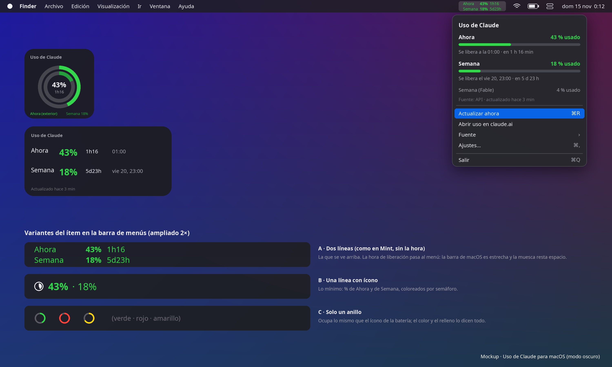

# macOS — Uso de Claude en la barra de menús

Port a macOS del applet de panel que ya funciona en Linux Mint
([`../linux-mint/claude-usage-applet/`](../linux-mint/claude-usage-applet/)). Muestra en la barra
de menús cuánto llevás gastado de tus límites de Claude y cuándo se liberan, con colores de
semáforo.

## Para el humano



```text
BARRA DE MENÚS   Ahora   43%  1h16        ← % usado del bloque de 5 h · cuánto falta para que se libere
                 Semana  18%  5d23h       ← % usado del bloque de 7 días · cuánto falta
COLOR            verde < 60 % · amarillo 60–84 % · rojo ≥ 85 %   (cada fila por separado)
CLIC             menú con el detalle: barras de progreso, "se libera a la 01:00 (en 1 h 16 min)",
                 Actualizar, Abrir claude.ai, Fuente, Ajustes, Salir
FUENTE DEL DATO  API de uso de Claude (por defecto, cada 5 min) o el statusline de Claude Code
REQUISITO        tener Claude Code instalado y con sesión iniciada en claude.ai (Pro/Max/Team)
```

**Qué significan "Ahora" y "Semana".** Claude limita el uso por bloques: uno de **5 horas**, que
empieza con tu primer mensaje, y otro de **7 días**. Las duraciones son iguales en todos los
planes; lo que cambia según el plan es cuánto uso cabe en cada bloque. El porcentaje es cuánto
llevás gastado del bloque actual. Al llegar a 100 %, Claude te frena hasta que el bloque se
libera.

### Cómo arrancar

Cloná este repo, abrí Claude Code dentro y pedile:
*"implementá la sección **Para la IA** de `macos/spec-claude-usage-menubar.md` en este mac"*.

Va a necesitar que hagas tres cosas:
- Instalar las Command Line Tools de Xcode, si no las tenés.
- Aceptar el aviso del Llavero ("Permitir siempre") la primera vez que el programa lea la sesión
  de Claude Code.
- Probar vos los clics: Claude no simula mouse en tu escritorio.

---

# Para la IA — leé esto antes de tocar nada

Este spec es autocontenido: **no necesitás nada de la conversación en la que se creó.** La
implementación de referencia, en Python + GTK para Linux, está en
`linux-mint/claude-usage-applet/` del mismo repo. Leela: la lógica (fuentes, formatos, semáforo,
estados) es la que tenés que replicar. Lo único que cambia es la UI y dónde está el token.

## Qué vas a dejar instalado

1. **Una app de barra de menús sin ícono en el Dock** (`LSUIElement`), en
   `~/Applications/Claude Usage.app`, que arranca al iniciar sesión.
2. **El ítem de la barra:** dos filas en columnas alineadas, `Ahora 43% 1h16` / `Semana 18% 5d23h`,
   coloreadas por semáforo. Es la variante **A** del mockup.
3. **Un menú al hacer clic**, con el detalle y las acciones. Ver el mockup y la sección "UI".
4. **Ajustes:** fuente (API o statusline), intervalo de la API (1, 5 u 8 min), umbrales del
   semáforo, colores, mostrar u ocultar la fila Semana.
5. **Opcional, fase 2:** widgets de escritorio con WidgetKit (pequeño con anillos, mediano con
   columnas). Hacelo solo si el humano lo pide; WidgetKit exige un proyecto de Xcode con
   extensión.
6. **Código en `macos/claude-usage-menubar/`**, con `install.sh` y `uninstall.sh` idempotentes,
   como el resto de `macos/`.

## Reglas duras (no las cambies sin decírselo al humano)

- **Nunca renueves el token OAuth.** Solo leelo. Si está vencido, no uses la red, mostrá el estado
  "desactualizado" y esperá a que Claude Code lo renueve. Si lo renovaras vos, rotarías el
  refresh token y podrías cerrar la sesión de Claude Code.
- **Nunca imprimas el token**, ni en logs, ni en el menú, ni en la salida de comandos. Para
  verificar el Llavero, mostrá solo las claves del JSON, no los valores.
- **Solo lectura:** un `GET` al endpoint de uso y nada más.
- **Nombres visibles:** "Ahora" y "Semana", nunca "Sesión". "Sesión (5 h)" confundió al usuario,
  que lo leía como "cuánto llevo trabajando".
- **Semáforo por defecto:** amarillo desde 60 % usado, rojo desde 85 %. Si los umbrales se cruzan,
  gana el rojo.
- **Intervalo de la API:** solo 1, 5 u 8 min; 5 por defecto.
- **El instalador de statusline no reemplaza** un statusline existente: lo envuelve y hace un
  respaldo de `~/.claude/settings.json` antes de escribirlo.
- **Nada de carpetas de trabajo fuera del repo:** lo temporal va en `/tmp`, lo que se conserva va
  en `macos/claude-usage-menubar/`.

## Datos: las dos fuentes

### Fuente A — API de uso (por defecto)

```http
GET https://api.anthropic.com/api/oauth/usage
Authorization: Bearer <accessToken>
anthropic-beta: oauth-2025-04-20
User-Agent: claude-usage-menubar
```

Es un endpoint **no oficial**, el mismo que usa `/usage` en Claude Code, así que puede cambiar:
parsealo con tolerancia y, si falla, mostrá "sin datos" o "desactualizado" en vez de romper.
Respuesta real de un plan Team (recortada a lo que se usa):

```json
{
  "five_hour": { "utilization": 20.0, "resets_at": "2026-11-15T06:00:00.920692+00:00" },
  "seven_day": { "utilization": 15.0, "resets_at": "2026-11-21T04:00:00.920712+00:00" },
  "limits": [
    { "kind": "weekly_scoped", "percent": 4,
      "scope": { "model": { "id": null, "display_name": "Fable" } } }
  ]
}
```

- `five_hour` → **Ahora**, `seven_day` → **Semana**. `utilization` va de 0 a 100 (en la práctica,
  enteros). `resets_at` es ISO-8601 en UTC.
- Cada entrada de `limits` con `kind == "weekly_scoped"` → una línea extra en el menú,
  `Semana (Fable): 4 % usado`.
- **Sin cabeceras de rate limit.** Política de consultas:
  - cada N min (1, 5 u 8), con variación aleatoria de ±10 %;
  - ante un error, el intervalo se duplica en cada fallo, con un tope de 30 min; si la respuesta
    trae `Retry-After`, se respeta;
  - una consulta extra justo después de cada `resets_at` (con un margen de 20 s);
  - "Actualizar ahora" consulta como máximo una vez cada 30 s;
  - si el token está vencido, no se consulta.
- **Dato desactualizado:** cuando hubo error, o cuando el dato tiene más de
  `max(3 × intervalo, 15 min)`.

**Dónde está el token en macOS. Verificalo en el preflight.** En Linux está en
`~/.claude/.credentials.json`, con esta forma:

```json
{ "claudeAiOauth": { "accessToken": "…", "refreshToken": "…", "expiresAt": 1794733621503,
                     "subscriptionType": "team", "rateLimitTier": "default_claude_max_5x" } }
```

En macOS lo más probable es que Claude Code lo guarde en el **Llavero**, como contraseña
genérica, con un JSON de la misma forma. El nombre del servicio que se espera es
`Claude Code-credentials`, pero **no está verificado**. Para confirmarlo sin imprimir el
secreto:

```sh
security find-generic-password -s "Claude Code-credentials" -w 2>/dev/null \
  | python3 -c 'import sys,json; d=json.load(sys.stdin); print(list(d), list(d.get("claudeAiOauth",{})))'
```

Si eso no devuelve nada, buscá el servicio correcto con `security dump-keychain | grep -i claude`
(muestra solo los atributos, no los secretos) y probá también `~/.claude/.credentials.json`.

- `expiresAt` está en **milisegundos**.
- La app tiene que releer el token **en cada consulta**, porque Claude Code lo rota cada pocas
  horas.
- Al leer un ítem del Llavero que es de otra app, macOS muestra un aviso: el humano elige
  "Permitir siempre".

### Fuente B — statusline de Claude Code

Claude Code ejecuta el comando de `statusLine` de `~/.claude/settings.json` con un JSON por stdin.
**Ya se verificó que con el plan Team incluye esto:**

```json
"rate_limits": {
  "five_hour": { "used_percentage": 24, "resets_at": 1794722400 },
  "seven_day": { "used_percentage": 15, "resets_at": 1795233600 }
}
```

- Acá `resets_at` está en **epoch en segundos**, no en ISO.
- El bloque llega solo después de la primera respuesta de cada sesión.
- Claude Code ejecuta el script con cada mensaje, con 300 ms de debounce, y también cuando llega
  un `resets_at`. No hace falta `refreshInterval`.

**Script reutilizable tal cual:** `linux-mint/claude-usage-applet/bin/claude-usage-statusline`.
Es Python 3 sin dependencias; las Command Line Tools traen `/usr/bin/python3`.
- Escribe `~/.cache/claude-usage/usage.json` de forma atómica y solo si el uso cambió, con este
  formato:
  `{"version": 1, "updated_at": <epoch>, "rate_limits": {…igual que arriba…}}`.
- Si en una sesión todavía no llegó `rate_limits`, no pisa el último dato bueno.
- Con `--wrap-b64 <base64 del comando previo>` ejecuta el statusline que ya existía y devuelve su
  salida.

La lógica de instalar, envolver y desinstalar está en
`linux-mint/claude-usage-applet/src/claude_usage/statusline_install.py`; portala o reutilizala.
La app vigila ese archivo con `DispatchSource`/FSEvents sobre la carpeta, porque el script lo
escribe con rename atómico. Con esta fuente, que no lleguen datos nuevos **no** cuenta como
desactualizado: significa que no se está usando Claude.

**Bloque ya liberado:** si `now >= resets_at`, el uso real de ese bloque es 0 aunque el dato sea
viejo. Mostrá `0%` y `nuevo`.

## Formatos exactos (copialos de `model.py`; los tests de `tests/test_core.py` sirven de vectores)

| Qué | Regla | Ejemplos |
|---|---|---|
| Cuenta regresiva (barra) | `<60 min` → `Nm`; `<24 h` → `HhMM`; si no, `NdHh` (o `Nd` si H=0) | `45m`, `1h16`, `5d23h`, `2d` |
| Hora de liberación | `<24 h` → `HH:MM`; si no, `día N, HH:MM` (lun mar mié jue vie sáb dom) | `01:00`, `vie 20, 23:00` |
| Detalle (menú) | `se libera a la(s) HH:MM (en X h Y min)` o `se libera el vie 20, 23:00` | `se libera a la 01:00 (en 1 h 16 min)` |
| Porcentaje | entero si es entero, si no, un decimal | `43 %`, `23.5 %` |

## UI (ver `claude-usage-menubar/mockup.png`)

- **Ítem de la barra:**
  - Dos filas con una fuente de unos 9–10 pt y columnas alineadas: nombre, porcentaje en negrita
    alineado a la derecha, cuenta regresiva. **Sin** la hora: la barra es angosta y la muesca
    resta espacio.
  - Cada fila lleva el color de su nivel.
  - Con `MenuBarExtra` de SwiftUI no se puede armar una etiqueta de dos líneas con columnas. Lo
    más probable es que necesites `NSStatusItem` con una vista propia (`NSView`, o un
    `NSHostingView` puesto en el botón del ítem).
- **Estados:**
  - Desactualizado: todo en gris y `43%?`.
  - Sin datos: solo `Claude` en gris.
  - Bloque liberado: `0%` y `nuevo`.
- **Menú:**
  - Título "Uso de Claude".
  - Para Ahora y Semana: nombre, "N % usado" en el color del semáforo, una barra de progreso y
    debajo "Se libera a la 01:00 · en 1 h 16 min".
  - Las líneas extra de `weekly_scoped`.
  - "Fuente: API · actualizado hace N min".
  - Un separador y las acciones: Actualizar ahora `⌘R`, Abrir uso en claude.ai
    (`https://claude.ai/settings/usage`), Fuente ›, Ajustes… `⌘,`, Salir `⌘Q`.
- **Colores por defecto**, del sistema en modo oscuro: verde `#32D74B`, amarillo `#FFD60A`, rojo
  `#FF453A`. Con apariencia clara, usá los equivalentes del sistema para que se lean bien.

## Stack sugerido

- **Lenguaje:** Swift con AppKit (`NSStatusItem`), más SwiftUI para el menú y los ajustes si
  te sirve.
- **Red y lectura:** `URLSession` para la API y `Security.framework` (`SecItemCopyMatching`) para
  el Llavero.
- **Arranque al iniciar sesión:** `SMAppService.mainApp`.
- **Build sin Xcode completo:** `swiftc` o SwiftPM. `install.sh` arma el `.app` (con
  `Info.plist` y `LSUIElement=1`), lo firma ad-hoc (`codesign -s -`) y lo copia a
  `~/Applications`.
- **Requisito mínimo:** macOS 13. Confirmá la versión real en el preflight.

## Preflight (hacelo y contale el resultado al humano antes de construir)

```sh
sw_vers; uname -m
xcode-select -p && swift --version          # si falla: xcode-select --install (humano)
claude --version
# token: el comando de security de arriba (solo claves, nunca valores)
```

## Criterios de aceptación

- [ ] Con la fuente API, la barra muestra los mismos porcentajes que `/usage` en Claude Code,
      con un margen de ±1 %.
- [ ] El color cambia en 60 % y en 85 %, y cada fila tiene el suyo.
- [ ] Con el token vencido: no hay tráfico de red, se ve el estado desactualizado y se recupera
      solo cuando Claude Code renueva el token.
- [ ] La fuente statusline funciona con y sin un statusline previo, y desinstalarla deja
      `settings.json` como estaba.
- [ ] El token no aparece en ningún log ni salida.
- [ ] `install.sh` y `uninstall.sh` son idempotentes.
- [ ] Hay tests de los formatos y del semáforo con los mismos vectores que
      `linux-mint/claude-usage-applet/tests/test_core.py`.
- [ ] El humano probó los clics, el menú y los ajustes.
