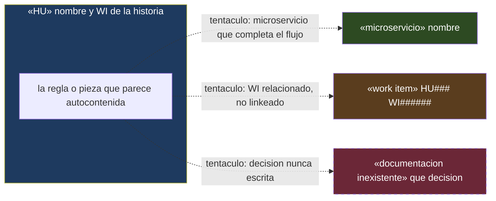
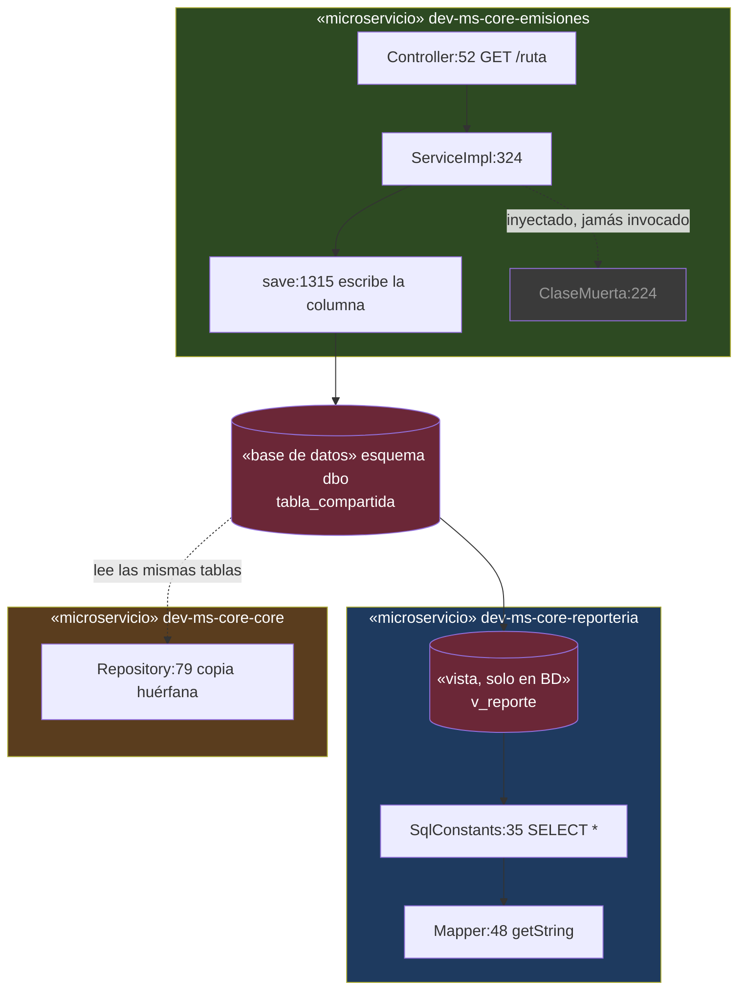

### Arquetipo — mapa de tentáculos

Un "tentáculo" es todo lo que está realmente involucrado en una HU/sistema sin vivir en su
expediente declarado: otro work item, otro microservicio que completa el flujo, una decisión
real que nunca se documentó. Cuando el humano necesita ver **hasta dónde se extiende** algo
que parece pequeño, ese es el modelo mental — no "proceso" ni "organización conceptual".

No usar `mindmap` (no tiene dirección ni frontera) ni `stateDiagram` (no hay transición
temporal aquí). Usar `flowchart` con la HU como `subgraph` (la frontera declarada) y cada
tentáculo como arista **punteada** que cruza ese límite — el punteado es la señal visual de
"esto no vive en el expediente pero está conectado". Estereotipo `«tipo» nombre` en cada nodo
externo, color por tipo de tentáculo (no por estética):

**Qué observar (enséñale esto al externo, no solo el diagrama):** el nodo central es
deliberadamente pequeño — la lección es que la complejidad real vive afuera del rectángulo,
no adentro. Línea punteada = cruza la frontera declarada; una línea sólida sería scope
documentado. El nodo de tipo "documentación inexistente" lleva además borde punteado en el
nodo mismo: ni siquiera tiene un artefacto formal detrás.

### Arquetipo — componentes de microservicios (el de referencia con `/backend`)

**Cuándo:** siempre que se trace un flujo que toca código de más de un repo, o cuando el humano
pregunte "qué clases / qué capas / de dónde a dónde va esto". **Es el arquetipo de referencia cuando este skill
se usa en conjunto con `/backend`** — un flujo de clases sin decir en qué microservicio vive cada
una es incomprensible para un externo, y fue exactamente el fallo que motivó este arquetipo
(2026-08-20, HU584: se entregó la cadena de clases sin los servicios y el humano no pudo leerla).

**La regla estructural:** cada microservicio es un `subgraph` con estereotipo
`«microservicio» nombre-del-repo`. Las clases van **dentro** de su subgraph, con `archivo:línea`.
Nunca sueltas.

**Lo que el diagrama tiene que revelar — no es decoración, es el hallazgo:** *cómo* se cruza la
frontera entre servicios. Un nodo cilindro `[(...)]` para la base de datos o la cola cuando el
cruce es por dato compartido, y una flecha directa entre subgraphs cuando es por HTTP. Para un dev
acostumbrado a microservicios que se hablan por API, descubrir que **no se hablan y comparten
esquema de BD** suele ser la información más valiosa del diagrama.

**Convenciones de color, por significado y no por estética:** un color por microservicio (para que
el ojo agrupe), rojo para el punto de cruce (BD/cola) y para los puntos de escritura, gris para
código muerto, punteado para "existe pero no se invoca" o "lee sin que nadie lo sepa".

**Cierra siempre con la tabla de "dónde comprobar cada cosa"** — la ruta local del repo por cada
pieza, incluyendo explícitamente lo que **no** está en ningún repo (vistas de BD, DDL sin Flyway) y
las trampas de nombre (un repo que por su nombre parece contener algo y contiene otra cosa).

| Qué comprobar | Dónde |
|---|---|
| La resolución del nivel (el bug) | el repositorio de emisiones |
| Cómo se pinta en el reporte | el repositorio de reportería |
| La vista v_584 | No está en ningún repo, solo en la BD |
| dev-ms-core-politicas | Trampa: es el ms de Salud, no tiene políticas |

---
