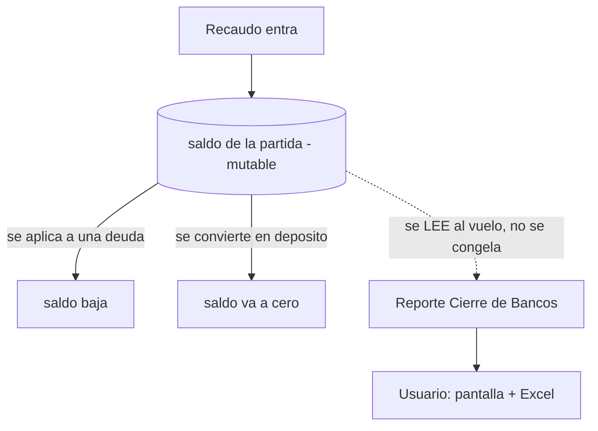
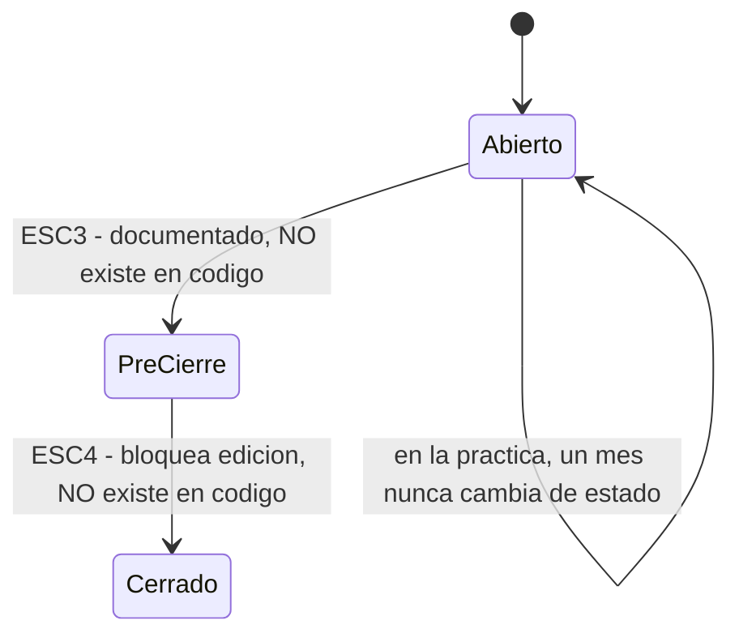
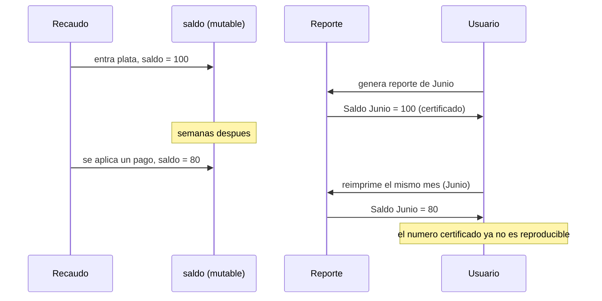

## Ejemplo real — HU770 "Cierre de Bancos" (WI 406685)

Impartición completa validada en batería de pruebas (2026-08-19), aplicando anclaje de
términos, matriz pedagógica y criterio de completitud de punta a punta.

> Verificado por el oráculo funcional contra código vivo (`dev-ms-core-reporteria`,
> `dev-ms-core-core`, `dev-web-front-core`) y el .docx aprobado — no de memoria.

**Anclaje de términos** (antes de seguir, porque son prerrequisito crítico):

```text
recaudo         la plata que efectivamente entró a la aseguradora (distinto de lo facturado)
detalle_recaudo cada partida individual de dinero recibido
medio de pago   el canal por el que entró (debito, PSE, consignacion)
saldo           lo que queda pendiente de una partida de recaudo (puede bajar con el tiempo)
deposito        dinero recibido sin que se sepa aun a que poliza/persona pertenece
pre cierre      revision manual previa a "congelar" un periodo
cierre definitivo  congelar el periodo y prohibir editarlo
```

**1. Concepto.** A pesar del nombre, esto no es un cierre ni una conciliación bancaria: es una
pantalla que consulta cuánto recaudo entró en un mes, agrupado por banco y medio de pago, y lo
exporta a Excel. No bloquea nada, no compara contra ningún extracto bancario — 4 endpoints
`GET`, ni un solo `POST`/`PUT` en el código.



*Qué observar:* el reporte lee un stock que sigue vivo en otro módulo (cartera). No hay ninguna
flecha que diga "congelar" — porque esa operación no existe en el código, aunque el documento
aprobado la describe.

**2. Lo documentado vs. lo real.**



*Qué observar:* el .docx aprobado define 4 escenarios; solo los dos primeros (filtrar y ver)
están implementados. Un "mes cerrado" y uno abierto son indistinguibles para el sistema.

**3. El efecto retrasado.**



*Qué observar:* la vista agrupa por fecha de recaudo (fija) pero suma saldo (vivo). El mismo
mes, consultado dos veces, puede dar dos números distintos, sin error visible en pantalla —
un stock mal delimitado: se reporta como fijo (un cierre) algo que sigue cambiando.

**Contexto / leverage point.** Controlable: los filtros. Restricción real: la regla de negocio
exige filtros obligatorios pero el backend los ignora (`WHERE 1=1`) — sin filtros, devuelve
todo el histórico. Dos work items del mismo tema en estados incompatibles (uno en UAT, la
pieza de pre-cierre todavía en Refinamiento). Leverage point: congelar el estado de un periodo
resolvería de un golpe la deriva del Saldo y haría implementables ESC3/ESC4.

**Verificación de completitud** (cierre explícito, no implícito):
- Términos críticos anclados antes de usarse.
- Núcleo cubierto: qué es, qué mide, por qué el Saldo no es estable, qué falta vs. lo documentado.
- Gap no resuelto marcado como tal, no inventado (magnitud real de la deriva: requiere BD dev,
  no se afirmó sin evidencia).
- Comprensión declarada **no demostrada** hasta tener una señal real del humano — se cerró la
  impartición con una pregunta de comprobación, no con un "espero que quede claro".

**Por qué es un buen ejemplo:** tres diagramas, cada uno responde una pregunta distinta (qué
mide / qué falta vs. lo documentado / por qué el número no es reproducible) — ninguno repite
al otro. Ningún término de dominio quedó sin anclar. El cierre no asumió comprensión.
